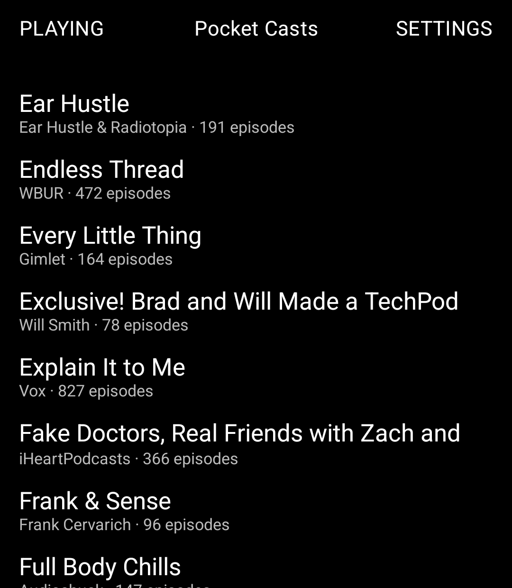
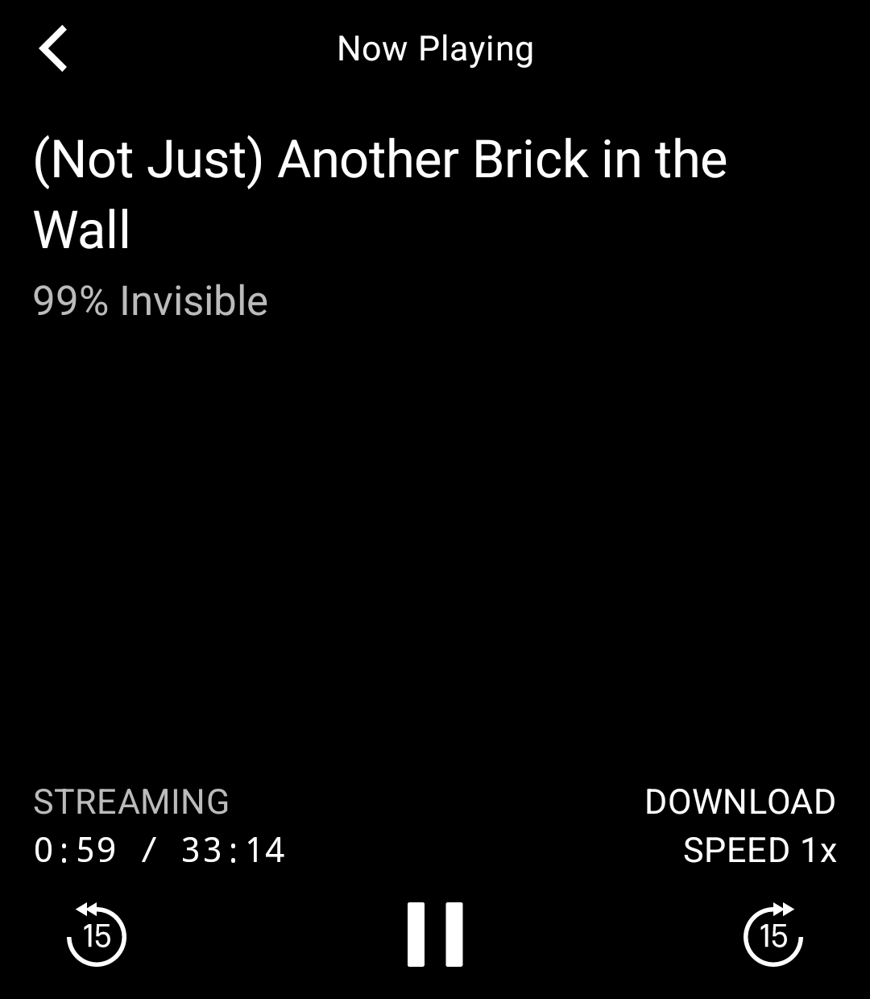

# Pocket Casts for the Light Phone

I've used Pocket Casts for years, and the one thing keeping a smartphone in my pocket was the podcast queue on it. LightOS ships a perfectly good Podcast tool — but it doesn't know what I listened to on my laptop this morning, and I didn't want to go back to dragging MP3s around like it's 2006.

So this is a tool for the Light Phone III that signs into your Pocket Casts account and picks up where your other devices left off.

<p>
  
  
</p>

**This is unofficial.** It isn't made by, endorsed by, or affiliated with Pocket Casts or Automattic. It talks to the same API their web player uses, which is undocumented and could change or close whenever they like. If that happens, this tool breaks until someone (probably me) fixes it.

## What it does

- Signs in with your Pocket Casts email and password
- Shows your subscribed podcasts and their episodes, cached so the list opens without a connection
- Streams episodes, or downloads them for offline listening
- Keeps playing with the screen off or after you leave the tool
- Syncs listening position both ways — start on the web, finish on the phone
- Syncs Up Next both ways: play next, play last, remove, move to top
- Archive and star, synced with your account
- Play/pause, 15-second skips, playback speed

## What it doesn't do (yet)

- **Google or Apple sign-in.** There's no browser on the phone, so only email-and-password accounts work.
- **Search or subscribe.** Add shows from another device and they turn up here on the next refresh.
- **Auto-download.** Downloads are one episode at a time, by hand.
- Show notes, chapters, bookmarks, folders, filters, stats, rating.

## What leaves your phone

The tool talks to two hosts, both run by Pocket Casts, plus whichever server hosts the audio for an episode you play or download.

| Where | What gets sent |
| --- | --- |
| `api.pocketcasts.com` | Your email and password at sign-in. After that an access token, your listening positions, played/archived/starred state, and Up Next changes. |
| `cache.pocketcasts.com` | The ID of a podcast, to fetch its episode list. No account details. |
| The podcast's audio host | A plain request for the audio file, same as any podcast app makes. |

That's all of it. No analytics, no crash reporting, no ads, and nothing goes to me.

Your password is used once to sign in and is never stored. The tokens it's traded for sit in the tool's private storage on the phone. Signing out deletes everything the tool knows about your account from the device — library, queue, unsynced changes, downloads.

The only permissions it asks for are network access and network state (so it can tell you you're offline instead of failing mysteriously).

## How the repo is laid out

This is a copy of [lightphone/light-sdk](https://github.com/lightphone/light-sdk) with the tool living in [`tool/`](../tool). Everything outside `tool/` is Light's, untouched. That's how Light's build server wants it: it takes `tool/build.gradle.kts`, `tool/lighttool.toml` and `tool/src/main/`, and compiles them against its own copy of the SDK.

The parts worth reading, under `tool/src/main/kotlin/com/jomurgel/pocketcasts/`:

- `data/api/` — the Pocket Casts HTTP calls and their JSON shapes
- `data/sync/SyncBackend.kt` — the interface the rest of the tool talks to. Pocket Casts is one implementation; a gpodder-style or plain-RSS one could replace it without touching the UI.
- `data/` — library cache, progress and episode-state outboxes, Up Next, downloads
- `playback/` — the one player the tool owns, and the logic keeping it in step with Up Next
- `ui/` — screens, built with Light's UI library

## Building it

You need Android Studio (or a JDK 17+ and the Android SDK). Light's own [README](../README.md) and [docs](../docs) cover the environment and the LightOS emulator in detail.

```bash
./gradlew :tool:testDebugUnitTest   # unit tests
./gradlew :tool:assembleDebug       # debug APK
```

To run it on the LightOS emulator, swap the `serverPackage` line in `tool/lighttool.toml` for the commented one above it, then:

```bash
./gradlew :tool:installDebug -DlightSdk.allowAltServerPackage=true
```

Don't commit that swap. Light's build server only accepts `com.lightos`.

## Status

It works against my own account on the LightOS emulator. It has not yet run on a real Light Phone III or Light Flip (waiting on an order) — I'll update this the day it does.

Bugs and pull requests are welcome. If something here misbehaves with your account, an issue with the steps is the most useful thing you can send me. Please don't paste tokens or passwords into it.

## License

MIT, same as the SDK it's built on. See [LICENSE](../LICENSE).
